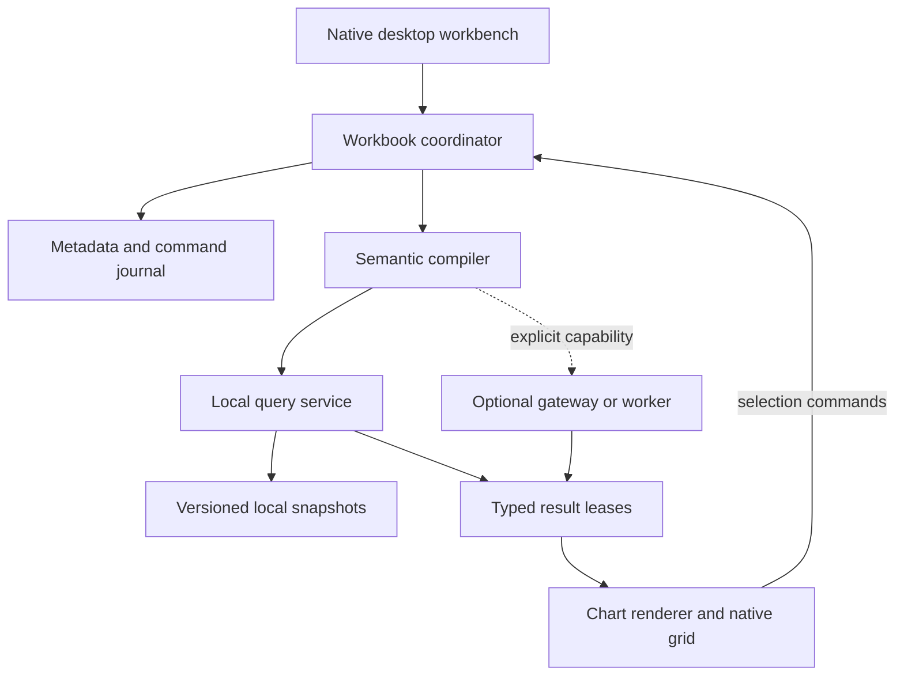
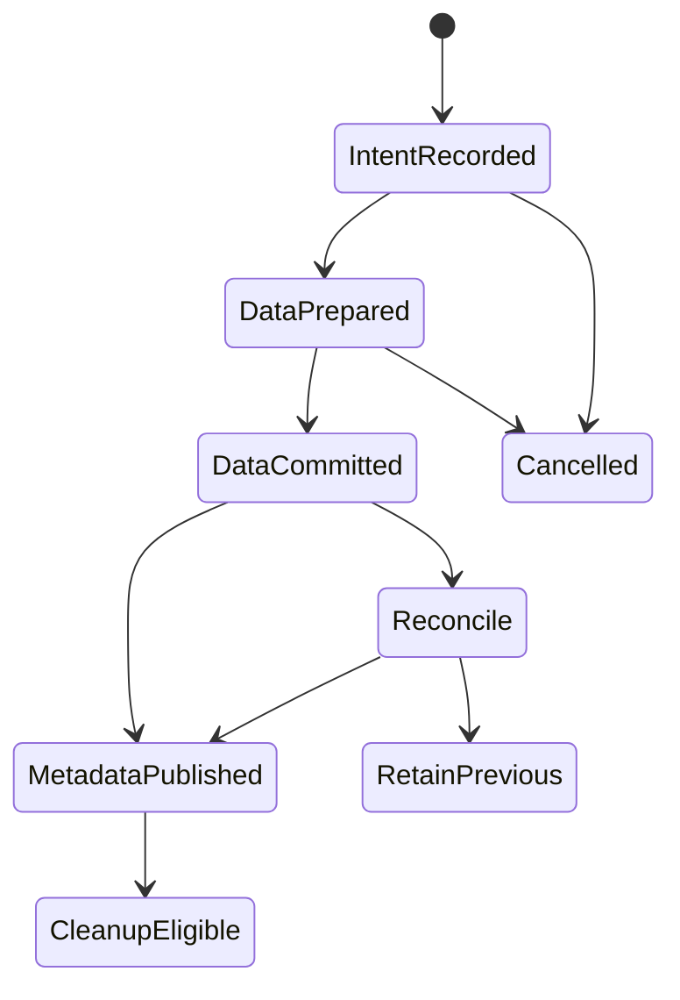

# Cloudy Data Architecture and Technical Specification

**Baseline:** 18 October 2026. **Status:** proposed implementation architecture with mandatory qualification gates. Read [the product contract](Cloudy_Data_01_Product_and_Design_Contract.md) first and use [the staged runbook](Cloudy_Data_03_Implementation_Roadmap_and_Agent_Runbook.md) for execution. Reference IDs resolve in file 03; CD identifiers resolve to the supplied-design ledger in file 01.

The recommended architecture is a native Android desktop workbench, a renderer-independent analytical model, a local native query service, and a bounded packaged chart renderer. Keep numerical meaning, file durability, permissions and history outside the chart renderer. Provide optional connector and compute services through the same versioned contracts, without making a VM or server necessary for ordinary local authoring.

## 1. Architecture decisions and alternatives

### 1.1 Selected stack

| Layer | Selected implementation direction | Why and qualification |
| --- | --- | --- |
| Desktop application | Kotlin, Jetpack Compose, AndroidX window/adaptive APIs | Native window lifecycle, desktop input, file grants and accessibility; wrap components in Cloudy roles. [P01, P03, CD09] |
| Domain and semantic compiler | Pure Kotlin/JVM modules with no Android UI dependency | Same semantic implementation can run in Android tests and a future JVM worker; renderer libraries never own calculation meaning. |
| Document metadata | Room/SQLite behind one WorkbookCoordinator | Transactional metadata/history, explicit migrations and consistent multiwindow state. The engine does not create an independent metadata authority. [P39] |
| Analytical storage/execution | Pinned DuckDB C API through NDK/JNI | Columnar analytical execution and local file processing; qualify Android and required extensions before adoption. [P04, P17, P18] |
| Native process boundary | Non-exported `:query` service initially | Contains most native engine crashes and provides a restart/cancel boundary. It shares the app UID and is not a security sandbox. [P11] |
| Bulk transfer | Bounded Arrow IPC over descriptor-backed streams | Retains typed columnar values; avoids large Binder objects and giant JSON arrays. A minimal nanoarrow-based adapter is a candidate, not an already qualified dependency. [P13–P15, P38] |
| Charts | TypeScript, pinned Vega and its CSP-compatible expression interpreter, bundled offline | A programmable visual grammar with Canvas/SVG output. Use generated trusted specifications and strict capabilities. [O07, O08, O12, O13] |
| Data/crosstab grid | Native virtualized grid with explicit cell-selection semantics | Integrates keyboard, clipboard and accessibility; two-dimensional virtualization is an S01 risk probe, not an assumed ready-made Compose table. |
| Network and credentials | Android native network/OAuth integration, Keystore-protected secrets | Network authority stays outside chart JavaScript. Pin actual libraries in S00. [P23, P24] |
| Deferred jobs | WorkManager only for appropriate durable jobs | Interactive queries use the bound service; Android background limits prohibit an assumed always-on scheduler. [P29, P30] |
| Optional gateway/worker | Versioned HTTPS service; reuse pure Kotlin semantics on JVM where practical | Adds qualified drivers, larger resource envelopes and external analytics. Python/R lives behind an explicit configured execution boundary. |

Do not require both a large web BI application and a native workbench. Do not install Python, Node, Jupyter, Termux, an X server or a Linux VM as hidden prerequisites of the APK. Those can be optional external tools when they serve an explicitly selected workflow.

### 1.2 Why the reference projects are useful

License entries below describe the cited upstream project boundary. S00 must inspect the exact shipped tag, package, assets and transitive dependencies; this table is not a complete distribution assessment.

| Reference | Useful ideas/components | Reuse decision and license boundary |
| --- | --- | --- |
| Apache Superset | Explore workflow, SQL workbench, chart plugin interfaces, source metadata and dashboard filters | Study design and narrowly reusable contracts. It is a server web BI system, not a drop-in Android/Tableau semantic engine. Apache-2.0 upstream; docs marked Next need release pinning. [O01, O02] |
| Metabase | Guided query steps, filter controls, clear source questions and dashboard interactions | Interaction reference. Core and enterprise code have different licensing boundaries; do not copy enterprise code or assume the whole repository is permissive. [O03, O04] |
| Grafana | Panel editing, time-range interaction, datasource adapters and diagnostics | Reference for panels/time-series workflows. AGPL-3.0 upstream; not the default embedded workbench. [O05] |
| Perspective | Incremental tables, pivot interaction and large-data exploration | Benchmark/reference and possible later isolated component. Apache-2.0. Its pivot semantics must not become a second authority beside Cloudy's compiler. [O06] |
| Vega/Vega-Lite | Declarative encodings, layers, facets, scales and interaction descriptions | Selected renderer family; BSD-3-Clause at the cited repositories. Generate visual specifications from Cloudy state. [O07, O08] |
| Apache ECharts | Broad chart vocabulary, interaction and accessibility examples | Useful implementation comparison. Apache-2.0. Do not add a second chart runtime unless a concrete unmet feature justifies the maintenance cost. [O09] |
| KNIME Analytics Platform | Inspectable preparation/analysis nodes and reproducible flow execution | Reference for later prep/analytics UX. GPLv3 with additional permissions; platform and extension terms must be evaluated individually. [O10] |
| Orange | Visual analysis workflows and approachable statistics | Reference for analytic explanations and flow interaction. GPL-3.0-or-later upstream; no assumed native Android embedding. [O11] |

The application must implement its own workbook, calculation and relationship contracts. None of these sources establishes drop-in Tableau workbook or semantic compatibility.

### 1.3 Feasibility branches

| Gate outcome | Required decision |
| --- | --- |
| Native DuckDB satisfies S01 correctness, persistence, ABI, memory, cancellation and package gates | Adopt its tested commit, configuration and adapter. Record unsupported extensions individually. |
| Native core works but an extension fails | Retain local core. Qualify another parser/adapter for that feature or offer an explicit worker; the missing capability stays partial/blocked. |
| Native engine remains unsuitable after bounded investigation | Test DuckDB-Wasm behind the same QueryService contract and the same correctness suite. Record a distinct memory/storage envelope. |
| Wasm cannot satisfy local workload requirements | Stop claiming the local engine gate has passed. Keep UI/domain work that is independent and present the concrete architecture decision to the owner. Do not silently require a server. |
| Vega surface fails native input/accessibility/performance gates | First repair the bounded host/bridge. If the failure is structural, prototype a native chart backend for the same MarkTable/ChartSpec contract and record an ADR. |
| Optional worker unavailable | Local supported workflows continue; worker-specific controls show endpoint/capability/recovery state. No automatic data upload to a substitute service. |

DuckDB-Wasm now supports OPFS persistence, but that does not make origin storage the sole durable document store. WebAssembly memory, WebView capabilities, storage clearing, browser networking and experimental threading still need measured limits. Cross-origin isolation and `SharedArrayBuffer` must be detected; an HTTPS asset origin alone does not establish them. [P06–P09]

## 2. Components, ownership and dependency direction



The dependency direction is UI → commands/domain → semantic plan → execution adapter. The renderer consumes results and emits typed interaction events. It cannot query a database, read a file, change a source credential, publish content, or edit the document directly.

### 2.1 Proposed repository modules

These are logical ownership boundaries; use existing repository conventions if they provide the same separation. Do not generate every module as an empty scaffold in the first task.

| Path/module | Responsibility | Must not own |
| --- | --- | --- |
| `app-android/` | Activities, application composition, intents, release integration | Analytical SQL construction or secret-bearing renderer messages. |
| `core/model/` | Versioned immutable workbook/schema objects and IDs | Android Views, raw engine handles. |
| `core/commands/` | Typed commands, revision checks, undo/redo and impact analysis | Uncontrolled source mutation. |
| `core/semantics/` | Type checker, formula AST, filter/grain/LOD/table-calc planner, backend capability lowering | Rendering state or Android storage paths. |
| `core/protocol/` | Control envelopes, capabilities, errors, Arrow schema metadata, transport versioning | UI-specific callbacks. |
| `core/persistence/` | Room metadata, command journal, manifests, migrations and recovery coordinator | A second DuckDB file writer. |
| `platform/android/` | SAF, intents, windows, Keystore, lifecycle, job integration | Product-specific numerical semantics. |
| `design-system/` | Canonical token import/generation, Compose wrappers, generated renderer theme tokens | Independently edited native/web palettes. |
| `engine/api/` | Engine-facing interfaces and capability/error mapping | Arbitrary widget access to SQL. |
| `engine/duckdb-native/` | Pinned NDK build, JNI ownership, chunks, interruption, native resource accounting | Remote credentials embedded in data packages. |
| `engine/service-android/` | Single writer registry, query scheduler, result leases and crash recovery | Direct public/exported service entrypoints. |
| `connectors/` | Typed source adapters, discovery, authentication, extraction and pushdown contracts | Guessing filesystem paths from URIs. |
| `features/` | Home, data, model, worksheet, dashboard, story, jobs, settings | Duplicate workbook stores. |
| `renderer-web/` | Offline Vega runtime, interpreter, safe visual lowering, selection/resize/export bridge | Business calculations, unrestricted navigation or arbitrary scripts. |
| `interop/` | Versioned Tableau/Hyper import-export adapters and conversion reports | Silent removal of unsupported constructs. |
| `services/gateway/` | Optional authenticated connector/compute job service | Mandatory dependency for local files. |
| `parity/`, `fixtures/`, `qualification/` | Atomic catalogs, independent oracles, hardware/render evidence | Fake pass results or private production datasets. |
| `docs/`, `.github/workflows/` | Decisions, execution state, bounded CI and package artifacts | Credentials, signing keys, moving dependency branches. |

### 2.2 Document and window ownership

Maintain one `WorkbookCoordinator` per open document in the application process and one app-level registry of document identities. It serializes accepted edits against `expectedRevision`. All Activities viewing that workbook observe its immutable state stream. Keep window-local layout/focus state keyed by `windowId`, rather than creating independent editable document copies.

The query service maintains one writable owner for each analytical database path. Several windows can share the same owner through requests; they must not each open an independent read/write DuckDB instance on that file. A future separate process or host must use the same single-writer ownership rule or a specifically qualified storage backend. [P10]

| State | Owner | Persistence rule |
| --- | --- | --- |
| Workbook definition, transforms, calculations, dashboard geometry | Coordinator/metadata repository | Durable command revision plus checkpoint. |
| Current dataset snapshots | Engine/snapshot registry | Immutable accepted version; change through prepared refresh/import operation. |
| Credentials and granted source access | Native source/credential broker | App-owned secure references; never serialized into a workbook. |
| Active tab, pane widths, pan/zoom, focus, open inspector | Window state controller | Per-window preference/restoration state, with bounded sizes. |
| Selection | Window/session by default | Save to workbook/story only through an explicit command or defined persistent action. |
| Query buffers/results | Query service and result-lease manager | Ephemeral; dispose on cancellation, expiry, window closure or revision invalidation. |
| Published policy and remote row access | Server authorization layer | Enforced for every query, inspection/export and cache retrieval. |

Multiple document windows are an Android task/instance workflow, not simulated browser tabs. Use stable document/window IDs in intents. Requested launch bounds are preferences; record observed bounds and respect OS placement/caption controls. [P03, P36]

## 3. Canonical document and type model

### 3.1 Core entities

| Entity | Required fields/meaning |
| --- | --- |
| Workbook | ID, format/semantic versions, revision, locale, time zone, source refs, model, fields, parameters, sheets, dashboards, stories, assets, capability requirements. |
| DataSource | ID, connector type/version, logical endpoint identity, source tables, access-reference key, live/extract mode, schema/version and freshness policy. |
| DatasetSnapshot | Immutable ID, source ID, schema hash, data asset refs, checksums, import/refresh operation ID, capture time, lineage, row count quality. |
| PhysicalTablePlan | Bound source/table IDs, joins, unions and explicitly permitted source queries; output grain and provenance. |
| LogicalTable | ID, physical plan, declared/observed grain and fields; remains distinct in the relationship graph. |
| Relationship | Table/field IDs, typed conditions, direction/scope metadata, declared cardinality and integrity with observation status. |
| Field | Stable ID, source lineage, physical/logical type, dimension/measure role, default aggregation, formatting, semantic annotations. |
| CalculatedField | Stable ID, original expression text, parsed typed AST, dependencies, calculation level, volatility and semantic version. |
| Placement | Unique occurrence ID, field/expression ID, shelf/channel, aggregation override, date level, discrete/continuous mode, sort and layer ownership. |
| Worksheet | Placements, filters with scope/stage, mark layers, panes, axes, legends, sorts, table-calculation specs, annotations and presentation settings. |
| Dashboard | Object tree, tiled/floating geometry, layout variants, action graph, source mappings and presentation behavior. |
| Story | Ordered points, captions, references and saved state/revision policy. |
| Operation | Stable ID, workbook/source identity, requested action, stage, commit receipt, progress facts, error/recovery and cancellation state. |

Field names are labels, never primary keys. Renaming a field updates its label; formulas, filters and charts remain bound by ID. Duplicate display names retain source qualification. A placement has its own ID because the same field can appear at different granularities or aggregations in one worksheet.

### 3.2 Type fidelity

The initial logical type system includes Boolean, signed integer widths, Decimal(precision, scale), floating-point, UTF-8 string, Date, local time, timestamp with declared timezone policy, duration/interval, binary, and explicit supported nested list/struct/map types. Add geometry as a typed logical extension only after S12 specifies CRS metadata.

Persist distinctions among SQL NULL, empty string, invalid parse, absent domain member, NaN/infinity where supported, imputed value, approximate value, and policy-suppressed data. Suppressed values should not be returned at all unless the policy explicitly permits an aggregate/suppression marker. NULL must not be serialized as the string `"null"` or as zero.

| Hazard | Required handling |
| --- | --- |
| Integer above JavaScript's exact integer range | Keep Int64 in Arrow/native types. Use typed decimal text/BigInt at the rendering boundary; preserve exact table/tooltip/export values. |
| Currency/decimal precision | Decimal math through calculation and aggregation; explicit rounding only where the formula or display requests it. |
| Chart coordinates | Convert only plotted coordinates to finite renderer numbers after scale planning; retain exact raw value and detect loss affecting meaningful geometry. |
| Timestamp precision | Store exact unit and timezone policy; JavaScript Date is not the canonical timestamp. |
| Locale/collation | Record sort/case/date parsing policy and required ICU/collation capability. Connector pushdown must meet the same contract or execute locally. |
| Nested values | Show structured inspection or explicit flatten/explode transforms; never silently stringify a nested value and treat it as a normal scalar. |
| Decimal overflow or invalid cast | Typed diagnostic and explicit reject/NULL policy; no silent float fallback. |

### 3.3 File format and portability

Use `.cloudydata` as the proposed portable workbook package and a versioned native data-source package if separate reuse is needed. The exact extension is a naming decision; the following content contract is mandatory.

| Package entry | Purpose |
| --- | --- |
| `manifest.json` | Format/semantic versions, workbook ID, entry inventory, hashes, dependency/capability manifest and producer build. |
| `workbook.json` | Canonical document model; no arbitrary JavaScript or shell scripts. |
| `data/` | Optional immutable Parquet/Arrow snapshots and declared source provenance. |
| `assets/` | Validated embedded images, approved local map resources, other bounded assets. |
| `preview/` | Optional nonauthoritative thumbnail and accessible summary. |
| `compatibility/` | Import report and preserved original/source fragments when a migration was requested. |

Portable analytical data should use stable interchange formats rather than requiring a particular DuckDB cache file version. A local engine database can be a rebuildable acceleration artifact. If a later package permits a database image for speed, it must declare engine compatibility and contain a consistent checkpoint; never ZIP a live `.duckdb` file and assume its WAL is unnecessary.

Enforce entry-count, nesting, decompressed-byte, compression-ratio, filename, path traversal and file-type limits before import. Disable XML external entities and external resource resolution in any compatibility parser. A manifest hash detects corruption; it is not proof of trust or encryption. Validate unknown future versions and preserve originals before migration.

Support metadata-only and data-inclusive exports, with the selected mode clear. Missing source credentials require reauthorization. A receiver opening a data-inclusive workbook can possess the included rows; a visual filter cannot enforce secrecy in a portable package.

## 4. Persistence, commands and crash recovery

### 4.1 Command contract

Every persistent user operation becomes a typed command with `commandId`, `workbookId`, `originWindowId`, `expectedRevision`, payload, affected entity IDs and an undo strategy. Examples: `AddPlacement`, `SetAggregation`, `ApplyFormula`, `SetFilter`, `MoveDashboardObject`, `ReplaceDataSource`, and `AcceptDatasetSnapshot`.

The coordinator validates permissions, references, types and revision. It writes the accepted command and updated metadata in one Room transaction, then publishes the new durable revision. Optimistic display may occur earlier, but it remains marked pending. A stale window edit is rebased only when the command's documented conflict rules prove it safe; otherwise return a conflict with both changes intact.

Undo restores previous model/data-version references, not repeated external side effects. Undoing a refresh can return to a retained snapshot; it must not issue an unbounded reverse operation against the source database. Text editor draft history stays local until Apply produces one workbook command. Gesture drags can preview continuously but commit one undoable command when complete.

### 4.2 Two-store transaction boundary

Room metadata and DuckDB analytical state are not one ACID transaction. Use an explicit durable state machine and immutable dataset versions.



1. Record the intended import/refresh operation and proposed snapshot ID in the metadata journal.
2. Build a new dataset version in owned staging. Record its source revision, schema, hashes and rejected-row policy. Keep the accepted old version available.
3. Commit analytical data together with its operation receipt inside the engine's transaction/storage boundary.
4. Validate that the committed snapshot exists and matches the expected receipt; atomically publish its pointer in workbook metadata.
5. Retain older versions while history, an export, or active readers refer to them. Garbage-collect only after reference reconciliation.

When the authoritative snapshot is an external Parquet/Arrow file set, a DuckDB transaction does not make those filesystem writes transactional. Fully write, close and validate each staged file; flush and finalize it on the same owned filesystem, with file/directory durability operations where supported and qualified, before committing the receipt that names it. Reconcile orphaned files and receipts on restart. Alternatively, store authoritative data and its receipt inside DuckDB transactional tables and treat external files as derived exports. S03/S04 must select one authoritative arrangement explicitly; `COPY TO` an external file must never be assumed rollback-safe merely because surrounding SQL used BEGIN/COMMIT.

On restart, inspect operation receipts rather than replaying a possibly completed import. If data committed but metadata did not, reconcile and publish only the exact validated snapshot or retain the previous version. If publication completed but a UI acknowledgement was lost, show the actual recorded result. “Completion unknown” is a valid temporary state; it must not become automatic duplicate execution.

### 4.3 Filesystem and SAF contract

Use `ACTION_OPEN_DOCUMENT`, `ACTION_CREATE_DOCUMENT`, and deliberately selected tree grants. Persist URI permissions when the provider offers them. A `content://` URI is not a filesystem path and may produce a nonseekable stream. [P27, P28]

Stream imports to app-private staging with a quota and cancellation. Keep writable databases, WAL, spill and metadata on a qualified local filesystem. Record the original source URI separately from the imported data copy. Refresh cannot assume the grant, provider, file identity or modification timestamp remains valid.

For external save/export:

1. Freeze one coherent workbook revision and dataset-snapshot set.
2. Produce and validate a complete local artifact under a stable operation ID.
3. Open the requested provider destination and stream the bytes.
4. Report provider-write success only after successful close and available verification. State that provider synchronization may be separate from local write completion.
5. Preserve the local artifact and prior valid project state on failure. If the provider cannot replace atomically or conditionally, show the exact overwrite/save-copy choices and do not claim race-free replacement.

Autosave in app-private storage and Save to an external document are separate outcomes. Display `Draft recovered`, `Saved locally`, `Export pending`, `Provider write failed`, or `Completion unknown` as appropriate. Do not lose accepted edits because an external provider is offline.

### 4.4 Migrations and backups

Version metadata, workbook schema, formula semantics, rendering schema, connector capabilities and engine storage separately. Migration runs on a copy with a before/after integrity report; retain the original until successful reopen. A newer app must not silently rewrite an older workbook's calculation semantics.

Exclude credentials and temporary result buffers from portable files. Define Android backup treatment for sensitive datasets and connection secrets explicitly; a Keystore key alone does not encrypt every database or exported workbook. Encrypted export, if implemented, needs a reviewed authenticated streaming format and recovery/key policy, not an improvised ZIP password flag.

## 5. Semantic compilation and numerical correctness

### 5.1 Intermediate representations

Use separate stages with inspectable structures:

1. **Workbook AST:** persisted analytical intent, including placement identities and source references.
2. **Typed expression AST:** resolved field IDs, types, calculation levels, dependencies, volatility and diagnostics.
3. **Logical query plan:** source/relationship scope, grain, filters, aggregates, LOD subplans, totals and table calculations.
4. **Execution plan:** native or remote operators, bound parameters, source snapshot/transaction policy, limits and capability decisions.
5. **MarkTable:** typed result at explicit pane/layer/mark grain, exact values, domain provenance and stable mark keys.
6. **ChartSpec:** visual encodings, axes, formatting, layout and interaction mappings over the MarkTable.

Do not use raw Vega JSON, handwritten widget SQL, or a saved chart screenshot as the canonical workbook. A visual library may position marks and resolve layout; it must not silently reaggregate results or decide LOD/filter meaning.

### 5.2 Calculation catalog and compiler

Each function entry declares name/aliases, argument and return types, supported calculation levels, NULL/empty/error behavior, deterministic or volatile status, aggregation behavior, native/remote lowering, connector restrictions, examples and independent tests. Audit the full applicable Tableau function inventory, not a convenient handwritten list of SUM/AVG. [T13]

Use a real lexer/parser and typed AST. A constrained grammar implemented with a maintained parser or a reviewed parser generator is acceptable; regex rewriting of arbitrary formulas into SQL is not. Field references resolve by ID after parsing labels. Limit expression length, nesting, graph size and evaluation work. Detect dependency cycles and unsupported functions before query submission.

Parameter values are bound values. Identifiers are generated from internal IDs through a backend-aware quoting layer. Never splice user values, display names, formulas or source paths directly into SQL. Preserve source-level diagnostic ranges so an error points to the actual formula segment.

Examples of semantic distinctions:

- `SUM(Profit) / SUM(Sales)` is not the average or sum of row-level profit ratios.
- COUNT of rows, COUNT of non-NULL field values, and COUNTD are different operations.
- ATTR returns one value only when the scope has a unique value under the reference's NULL rules; multiple-value ambiguity is a typed state, not an ordinary string `*` accidentally usable in arithmetic.
- Disaggregated marks operate at declared row identity; a grouping query is not a substitute.
- Volatile date/time functions use the documented query/workbook anchor and timezone. Cache invalidation must reflect that anchor.

### 5.3 Grain and relationships

A physical join intentionally constructs rows; duplicate matching keys can multiply a measure. A logical relationship retains separate table grains and requests aggregation/combination appropriate to the participating fields. [T01]

Represent these as different operators. Track each measure's originating logical table, grouping scope and relationship path. Plan only required tables; aggregate independent facts at their correct grouping keys before combining them. Keep declared cardinality/integrity distinct from measured evidence. Default to a correctness-preserving conservative plan when metadata is uncertain; never optimize based on a guessed one-to-one relationship.

For multi-fact models, use explicit base-table and shared-dimension objects. Detect ambiguous/cyclic paths and unrelated dimensions. Require source-specific fixtures for unmatched keys, NULL keys, many-to-many domains, cross-table calculations, repeated dimensions, and filters on a different fact. If a combination is not supported, produce a typed model error or a deliberately selected alternative, not a plausible duplicated total. [T02]

Data blending is a separate worksheet-level operation: source-qualified queries produce aggregate results, then combine through declared linking fields and primary-domain behavior. It is not simply another edge in a raw physical join graph. [T09]

### 5.4 Filter and LOD planning

Persist filter **stage**, **scope**, **source**, **dependencies** and **evaluation context**. The following relationships are mandatory; the full reference pipeline, including top/condition/set/latest-date variants, is frozen as atomic cases in S00/S08. Do not assume this short list implements every ordering rule. [T03, T04]

| Operation | Required ordering/meaning |
| --- | --- |
| Extract/source restrictions | Applied at their declared source/snapshot scope; remote authorization policy is even more fundamental and cannot be disabled by worksheet state. |
| Context filters | Constrain the relevant worksheet context before its FIXED calculation scope. |
| FIXED LOD | Evaluated at its explicit grouping before ordinary dimension filters. |
| Ordinary dimension filters | Constrain the view-level domain before INCLUDE/EXCLUDE evaluation and subsequent visible aggregation. |
| INCLUDE/EXCLUDE LOD | Add/remove dimensions relative to the declared view grain, with explicit outer reaggregation. |
| Measure filters | Filter aggregate results at their defined scope; are not interchangeable with row predicates. |
| Table calculations | Execute over the ordered mark-domain result according to addressing/partitioning. |
| Table-calculation filters | Hide resulting marks after calculations, preserving required earlier contributions. |

FIXED planning generally needs a distinct grouped subplan and controlled mapping back to the view grain. INCLUDE requires computing at an enlarged grain before outer aggregation. EXCLUDE computes at a reduced grain and maps values to the visible groups. Repeated LOD values do not automatically become additive totals.

Maintain predicate-movement barriers in the optimizer. Cache keys include filter stage/context and LOD scope. A backend cannot push a filter earlier merely to reduce scanned rows if doing so changes the answer. Top-N-with-context, relevant-value filters, latest-date presets, nested LOD, and cross-source limitations receive separate tests.

### 5.5 Table calculations, domain and totals

Use a `TableCalcSpec` containing ordered addressing dimensions, partition dimensions, sort/tie rules, frame bounds, restart behavior, missing-domain policy, nested dependencies and output type. Generic SQL window syntax may implement part of a case; it does not by itself define Tableau's mark-domain behavior. [T10]

The mark-domain builder distinguishes observed rows from generated missing date/bin members. Preserve a domain-provenance flag. NULL replacement functions act on existing values; they do not create absent observations. Recompute only when the corresponding source/domain/filter stage changes. [T12]

Totals are separate plan nodes. Recompute nonadditive aggregates over their correct underlying scope unless the user selects a documented two-pass total mode. For averages, ratios, distinct counts, LOD values and table-calculated measures, summing displayed cells is often wrong. Subtotals retain their own grouping scope. [T11]

An inspectable computation view should show mark order, grouping keys, partition boundaries, generated members, input values and calculated outputs. This is a user-facing diagnostic for difficult calculations and a required development oracle.

### 5.6 Cache and asynchronous results

A result stamp contains at least:

`workbookId`, `worksheetId`, `modelRevision`, `queryGeneration`, `semanticVersion`, `sourceSnapshotIds`, `parameterHash`, `filterContextHash`, `locale`, `timeZone`, `engineCapabilityHash`, and, remotely, `principal/policyVersion`.

Cache data results separately from visual layout. Resizing a window, switching shell appearance or opening an inspector should not rerun unchanged data calculations. A worksheet specification edit increments its query generation and invalidates incompatible leases. The UI accepts a completion only if the entire relevant stamp matches current state.

For a new filter, retaining the previous chart while computing is allowed only with a visible “Updating”/stale indication tied to the earlier filter state. A failed update must not relabel old values as current. Cancelled/failed work cannot publish a normal completed result.

## 6. Query service, IPC and native resource management

### 6.1 Control protocol

Define a versioned internal API, independent of the chosen transport:

| Operation | Contract |
| --- | --- |
| `GetCapabilities` | Engine/semantics/protocol versions, formats, functions, extension hashes, limits and execution location. |
| `PrepareSource` | Validate approved source descriptors/options and produce a staging operation; never accept arbitrary renderer paths. |
| `SubmitQuery` | Typed plan or approved compiled payload, result stamp, parameters, deadline, resource budget and cancellation identity. |
| `GetOperationStatus` | Reconcile a stable operation ID after lost acknowledgements or process restart. |
| `CancelQuery` | Idempotent request; distinguish accepted cancellation from actual terminal cancelled state. |
| `OpenResult` / `AcknowledgeBatch` | Bounded stream/lease creation and backpressure. |
| `ReleaseResult` | Idempotent cleanup of descriptors, buffers, cursor and pinned snapshots. |
| `CommitPreparedSnapshot` | Validate the exact prepared version/receipt and make it available for metadata publication. |
| `ExportResult` | Stream a fixed snapshot/result to an approved sink with scope and completion semantics. |

Use Binder/AIDL for small envelopes, not dataset rows. Set an initial 64 KiB control-message ceiling, including serialized metadata; larger plans/schemas use a bounded descriptor payload with independent limits. Android's shared Binder buffer is approximately 1 MB, not an available per-result quota. [P13]

Every reply includes protocol version, request/operation ID, result stamp and typed error details. Reject unsupported versions and invalid identities. The service is non-exported and validates callers/ownership even when a transport is normally private.

Binder death/disconnection, truncated Arrow streams and expired leases transition affected work to Interrupted, close its resources and retain the last accepted snapshots. Rebinding reconciles stable operation IDs before any retry. A process killed by OOM may never send a typed error or confirm cancellation; absence of a reply is not completion.

### 6.2 Bulk data protocol

Arrow IPC is the transfer format; Arrow C Data Interface pointers remain inside one process. [P15]

Start with 2 MiB target record batches and two batches in flight per active consumer as **probe settings**, then tune from measurements. Define maximum individual value/batch sizes, schema metadata limits, total result quotas, lease expiry, byte order/IPC version compatibility and dictionary replacement behavior. Large binary cells may require a separately leased asset rather than a huge inline object.

Use descriptor streams initially because they simplify bounded backpressure. Add read-only shared-memory buffers only after measuring a real bottleneck and proving protection, ownership and cleanup. Never advertise end-to-end zero copy without measuring the native → JVM → WebView path. [P14]

The renderer receives bounded chart/summary results, not entire imported datasets. A native grid requests visible rows/columns and virtualizes both dimensions. Exports stream through the service without constructing a million-row Kotlin list or JavaScript array.

### 6.3 Native adapter

Build Android Bionic binaries through NDK/CMake for `arm64-v8a` and `x86_64`. Desktop JDBC libraries or Linux ARM64 extensions are not substitutes. Freeze a tested DuckDB commit and matching dependency/extension sources; official instructions recommending `main` do not justify a moving release dependency. [P04, P05]

The adapter owns engine, connection, pending-query, chunk, appender and result lifetimes with deterministic destruction. All native calls execute off the Android main thread. Define which operations may run concurrently and which connection owns cancellation. Cancellation must reach the executing native connection, interrupt streaming and release all pinned buffers/snapshots.

Use the pinned engine's qualified chunk/pending/streaming interfaces. Fetching chunks after a fully materialized query does not bound the query's peak memory. Do not build the product around deprecated full-result Arrow entrypoints such as `duckdb_query_arrow`. [P17, P18, P26]

### 6.4 Initial resource policy

Measure total native, JVM, renderer/GPU, shared-buffer and storage consumption. DuckDB's `memory_limit` does not constrain every allocation. [P31]

| Resource | Initial probe setting or rule |
| --- | --- |
| Concurrent expensive local queries | One app-wide initially; interactive foreground work has priority over refresh/export. |
| Engine buffer budget | Start at 256 MiB for the baseline probe, then fit the measured OS/process envelope; no percentage-of-device-RAM entitlement. |
| Result buffers | Bounded batches and a small fixed in-flight count; no unbounded producer queue. |
| Data preview | 1,000 rows initially, with explicit pagination and sample status. |
| Plot marks | Start with a 100,000 visible-mark soft budget; offer declared binning/aggregation or a measured higher mode. Exact totals still use the full defined data scope. |
| Dashboard renderers | One renderer scene per visible dashboard window where practical, not one heavyweight WebView per chart; cap active instances after measurement. |
| Spill/cache | Separate owned directories, free-space reserve, configurable quotas, operation-linked cleanup and crash reconciliation. |
| Long-running operation | Deadline, progress facts, cancel route, resource refusal and recoverable prior state. |

Test wide strings, skew, high-cardinality joins, sorts, table calculations, multiple workbooks and minimized/background transitions. Android 17 documents RAM-dependent memory enforcement; newer budget APIs are optional and must be gated by actual API availability. Legacy memory-pressure callbacks are not a reliable warning before termination. [P32–P34]

An initial budget is not a promise that every query spills. Some operators or extensions allocate outside spillable structures. On resource exhaustion, return an accurate typed error and keep the accepted workbook/dataset usable.

## 7. Renderer, grid and dashboard implementation

### 7.1 Bounded renderer host

Load packaged assets through `WebViewAssetLoader` using a dedicated HTTPS app-asset origin. Bundle scripts, fonts, interpreter and schemas; no CDN requirement. Intercept and deny unexpected asset/network requests because asset-loader fallback alone is not a network allowlist. [P16]

Use an origin-restricted AndroidX WebKit message listener/port with runtime feature checks. Validate message type, main-frame/origin identity, session nonce, size, version, worksheet/window ID and result revision. Do not expose an unrestricted `addJavascriptInterface`, wildcard-origin receiver, generic SQL function or file path API. Binary transfer through WebMessage ArrayBuffer needs an explicit capability check and measured fallback. [P25]

Vega's default expression path uses generated functions. Select its documented expression interpreter for a strict CSP, generate AST-bearing specifications through the qualified API, and test the performance cost. Do not solve a CSP failure by enabling arbitrary evaluation for imported data. Only Cloudy-generated, validated visual expressions enter this renderer. [O12]

### 7.2 Renderer protocol

Host-to-renderer messages: `Initialize`, `ApplyChartSpec`, `AttachResult`, `SetSelection`, `SetViewport`, `SetTheme`, `RequestExport`, `Suspend`, and `Dispose`.

Renderer-to-host messages: `Ready`, `RenderComplete`, `SelectionIntent`, `HoverIntent`, `ContextMenuIntent`, `FocusExitIntent`, `ExportComplete`, `ResourceUsageSample`, and `RendererError`.

Messages carry scoped IDs and revisions. Aggregated mark identity is a canonical typed grouping key plus pane/layer identity. Disaggregated marks also require stable source-row identity within the snapshot, so duplicate-valued rows stay distinct; generated domain members require their own explicit member identity/provenance. Array position and displayed label are not durable identities, and a row ID is not assumed stable across refreshed snapshots. A click from an old result is rejected or explicitly reconciled before it affects a new dashboard filter.

Keep exact data values and display values separate. Tooltips render sanitized text/components, not raw HTML from fields. Disable arbitrary spec URLs, externally loaded transforms and unapproved images. External dashboard web objects, when introduced, use a separate restricted surface with no analytical native bridge or access to workbook credentials.

### 7.3 Recovery and accessibility

Handle `onRenderProcessGone`: discard the dead WebView, preserve document/selection state outside it, recreate a fresh renderer and replay the accepted safe state. Bound repeated restarts and show a recoverable chart error if necessary. Release Vega views/listeners and buffers when a sheet is hidden or destroyed. [P22, O13]

Every WebView sharing the terminated renderer must handle the callback, dispose its dead instance and return `true` after handling; repairing only the visible chart does not handle another affected instance. Track renderer ownership at the app/window level and distinguish renderer failure from whole-app process death. [P22]

Implement native summary, fields/units, filter context and an accessible data view for every plot. Support keyboard traversal of marks or an equivalent native exploration workflow, explicit focus exit, selected state and non-color cues. Decorative canvas pixels do not supply TalkBack semantics automatically. Test actual speech and physical input on Android, not only DOM accessibility attributes.

The native grid needs sticky headers, row/column/cell roles, visible focus, intentional two-axis scroll, range/additive selection, keyboard paging, precision copy, sort indicators, resize controls, and accessible row inspection. Virtualization must preserve logical row/column positions and focused-cell identity when recycling views.

### 7.4 Dashboard semantics and layout

Saved dashboard dimensions/layout variants are document properties. Android window resize changes the authoring viewport and shell reflow; it must not silently rewrite a fixed dashboard's geometry.

Use an object tree with stable IDs for containers, worksheet instances, legends, controls, text, images, navigation and extensions. A worksheet may appear more than once with independent presentation properties but shared analytical definition where declared. Keyboard move/resize and an outline tree provide alternatives to drag handles.

Apply dashboard interactions as a coherent action transaction. The reference documents parameter, set, filter, navigation, highlight and URL actions in a defined order, including ordering within an action type; encode and test that ordering against the pinned baseline. Prevent cycles/reentrant feedback and publish one coherent revision before dependent queries run. [T14]

Dynamic zone visibility affects layout, not authorization. Hiding a worksheet never removes data access from the current user's result/export capability. URL actions validate schemes/targets and use an explicit native navigation decision; workbook data must not generate automatic exfiltration requests on hover.

### 7.5 Export rendering

Freeze source snapshots, filters, parameter state, chart specs, fonts, theme and output dimensions under one export operation. Interactive previews and exported files must use equivalent semantic results.

Use the qualified Vega Canvas/SVG path for supported marks. Raster-dependent map tiles or images may force rasterized regions; report that clearly. Build print/PDF/PowerPoint layouts from the same scene/content contract, with page breaks, titles, legends, captions and source/snapshot notes. Native Android print APIs can provide the user flow; the actual PDF/export implementation is qualified in S16.

Inspect generated PNG/SVG/PDF/PPTX/XLSX outputs with real renderers/readers. A nonempty file or export-completed callback is not evidence that labels, totals, filters or pagination are correct. Do not claim PDF accessibility/tagging from visual similarity alone.

## 8. Source connectors, preparation and optional execution

### 8.1 Connector contract

Each adapter implements discovery, source schema, preview, query/extract, cancellation, refresh, type mapping, error mapping and capability negotiation. Publish a descriptor such as:

```json
{
  "connectorId": "postgresql",
  "connectorVersion": "pinned-by-S15",
  "executionModes": ["connector_service"],
  "queryModes": ["live", "extract"],
  "authentication": ["configured_supported_modes"],
  "capabilities": {
    "parameterBinding": true,
    "queryCancellation": true,
    "snapshotConsistency": "declared_by_adapter",
    "incrementalRefresh": "requires_configured_key_policy"
  }
}
```

The strings indicating pinning/configuration are schema examples, not completed runtime capability claims. Production descriptors come from actual adapter qualification. An absent driver capability cannot be represented by a success-shaped stub.

For live sources, record isolation/snapshot consistency across related queries. If an adapter cannot provide a coherent multi-query snapshot, expose the consistency limitation or materialize an extract. Push down only operations with verified type, NULL, collation, timezone and aggregate equivalence. Fetching an entire warehouse because a filter cannot be pushed down needs a bounded cost/data-movement decision, not an invisible fallback.

### 8.2 Local import details

- CSV/TSV: delimiter, quote, escaped/newline fields, header count, encoding, locale, leading-zero identifiers, duplicate headers, large integers and malformed-row policy.
- JSON/NDJSON: schema inference scope, heterogeneous records, nested fields, flatten/explode policy and missing-versus-null fields.
- Excel: workbook/sheet/range selection, merged headers, blank rows, mixed types, date-system differences, errors and cached formula values. Do not execute macros or imply full spreadsheet recalculation.
- Parquet/Arrow: nested types, dictionary changes, signedness/decimal/time units, corrupted metadata and bounded batch transfer.
- SQLite/DuckDB: read-only source import, schema inventory, extension requirements, locked/corrupt files, source-version compatibility and no automatic embedded SQL execution.
- PDF/statistical/legacy formats: named library/version and supported variants; show extraction preview and unresolved structure. Generic PDF text extraction is not table import parity.

The Android DuckDB extension repository does not supply every desktop extension. ICU, spatial/GDAL/PROJ, HTTPFS, Excel and database adapters must each be built or replaced through a qualified path. Downloading an approved HTTPS file with the native network layer before local import can avoid making HTTPFS mandatory for the first release. [P04, P05]

### 8.3 Preparation graph and incremental refresh

Transform nodes have stable IDs, ordered dependencies, input/output schema, parameters, deterministic/volatile status, schema migration, affected-row counts and sample/full evaluation state. Preview can use an explicitly labeled sample; accepted output has its own snapshot receipt.

Incremental refresh needs an explicit policy, not just “append rows whose timestamp is greater.” Define identity/key, watermark, tie handling, late-arriving records, updates/deletes, deduplication, transaction boundary, timezone and schema drift. Offer append-only only for sources whose contract supports it. Keyed upsert/delete capture and full replacement are different modes. Watermark advancement commits with the exact accepted dataset version.

Column rename/type changes produce impact analysis for formulas, relationships, filters, dashboards and exports. Do not bind by accidental column position or auto-convert a changed field until its semantics are reconciled.

### 8.4 Optional gateway and compute worker

Use HTTPS with verified server identity, short-lived enrollment, scoped tokens, revocation and renewal. A localhost/VM listener still requires authentication. Never globally bypass TLS errors. A connection profile names endpoint, execution location, allowed data/source scopes, limits and consent policy. [P23, P24]

The handshake includes protocol, semantic and engine versions; extension/function/connector hashes; supported query/refresh/export operations; cancellation; result retention; and resource limits. Mismatches produce a capability error or a tested compatibility path, not silent evaluation with different semantics.

A worker enforces authorization on every source ID, query, job, cached result, row inspection and export. Use read-only source accounts by default. Result-producing stored procedures and custom SQL are separately cataloged and require an explicit execution policy; a SELECT-only label does not make every table function or procedure safe.

Python/R analytical calls use declared schemas, row identity/order, package environment hashes, deterministic seeds where relevant, deadlines, CPU/memory/disk limits and isolated execution. Return typed results and model diagnostics. Imported scripts do not run on workbook open. A user-approved analytical job does not authorize arbitrary later scripts from the same file.

Googlebook's Linux terminal can host a worker if a real supported deployment and network route is established. The available public overview is not a universal APK API for launching arbitrary Linux processes, mounting its files, or assuming fixed localhost/vsock addressing. [P01]

## 9. Geography and analytics

### 9.1 Spatial execution

Separate the map scene from geographic computation. Coordinate plotting can work before geocoding, CRS conversion, geographic boundaries, spatial joins or tiled maps. It cannot count as their completion.

Store geometry type, CRS, units, axis order, validity and source precision. Test longitude/latitude reversal, projected coordinates, antimeridian crossing, poles, multipart geometries, holes, null/empty geometry and invalid input. Geodesic and planar distances are different operations; label units and supported assumptions.

Use a qualified native spatial stack where feasible; otherwise route the specific operation through an explicitly configured worker. A base-map provider needs endpoint, attribution, offline/cache policy and data licensing separate from the map-renderer software license. Packaged GeoJSON geometry can support a useful offline map without silently fetching tiles.

### 9.2 Statistical execution

Maintain an `AnalysisSpec` separate from the visual layer, with input variables, data snapshot, grouping, missing-value policy, algorithm/version, parameters, seed, fitted outputs and diagnostics. Use qualified numerical implementations and independent test references. Do not infer a model's correctness from a curve on a chart.

| Family | Required technical contract |
| --- | --- |
| Descriptive statistics | Sample/population definitions, quantile interpolation, outlier/box convention, weighted versus unweighted behavior. |
| Trend fits | Supported model equation, transformations, domain restrictions, coefficients, residuals, degrees of freedom and interval definition. |
| Forecasts | Model family, seasonality/trend/damping policy, estimation, missing periods, horizon, fit diagnostics and prediction intervals. |
| Clusters | Feature scaling, distance, initialization/seed, stopping, cluster count/selection and stable labeling; Tableau's documented scaling/count-selection behavior is part of the reference audit. [T21] |
| Predictive functions | Function-specific model and return meaning, supported input types, calibration/tolerances and invalid cases. [T33] |
| Explanation | Data and model evidence, scope, uncertainty and distinguishable generated narrative; no unsupported causal inference. |

A Python reference harness may be used in development to validate a portable implementation; that does not make Python an APK runtime dependency. If a native statistical operator is deferred to the optional worker, report its execution requirement and parity state accurately.

## 10. Security and trust boundaries

Security here protects private datasets, credentials, source systems and truthful analytical results. It does not introduce repeated confirmations for routine editing.

### 10.1 Threat and control matrix

| Boundary | Concrete risk | Required control |
| --- | --- | --- |
| Imported files/packages | Parser exploit, ZIP bomb, traversal, malformed columnar buffers | Size/structure limits, hardened parsers, staged parsing, fuzz corpora, updated dependencies and a documented isolation boundary. |
| Imported formulas/SQL | File/network access, unbounded resource use, arbitrary code | Parse typed formulas; disable autoexecution of custom SQL/scripts; bind source handles and parameters; use a real sandbox for untrusted SQL. |
| Chart/runtime content | XSS, unsafe expressions, unauthorized bridge calls | Bundled code, interpreter/CSP, origin/message validation, no dataset HTML or arbitrary network resources. |
| Source credentials | Exposure in workbook, logs, backups or chart data | Native secure storage, reference tokens, redaction, least scope and explicit backup handling. |
| Multiwindow/results | Wrong-workbook data, stale completion, cross-user cache leak | Full ownership/revision stamp, per-principal policy cache keys and lease validation. |
| External URLs/connectors | Exfiltration, SSRF on a server, redirects to private endpoints | Explicit source enrollment, validated destination policy, safe redirect handling and network restrictions at the worker. |
| Export/publish | Wrong data scope, unauthorized rows, partial output | Frozen snapshot, clear scope/destination, server-enforced policies, artifact validation and accurate completion state. |
| Extensions/analytics | Supply-chain code execution or unconstrained scripts | Pinned signed/hashed packages, capability manifests, isolated execution, no workbook-triggered extension installation. |

DuckDB treats SQL as privileged executable input and explicitly recommends proper sandboxing for untrusted SQL. Query settings are defense in depth, not a complete security boundary. [P19, P20]

The initial same-UID query service is permitted for app-generated validated plans over broker-approved sources. Do not call it sandboxed. Arbitrary imported SQL requires a separately qualified Wasm or genuinely isolated/brokered worker. An `isolatedProcess` Android service has no ordinary app permissions; descriptors, random access, temporary files and persistence need a real broker implementation. If that experiment fails, keep the capability disabled instead of reverting to same-UID execution while preserving a sandbox label. [P11]

### 10.2 Dependency and extension control

Disable unapproved extension autoinstall/autoload in the product configuration; explicitly activate only packaged, version-matched components. Do not copy the example Android build's convenience defaults as the release security policy. Gate file/network permissions and configuration changes with broker-owned policies; verify the actual flags supported by the pinned DuckDB commit. [P04, P05, P20]

Produce an SBOM and notices for native libraries, Kotlin/JVM, JavaScript/Wasm, fonts, icons, map resources and analytical packages. Record source commit, license, patches, build flags and vulnerability review. Check every transitive `.so` for ABI and page-size requirements, not only `libduckdb`.

## 11. Lifecycle and platform API map

### 11.1 Platform rules

- Use current usable window metrics, measured caption/control insets and display density. Preserve formula drafts and chart context through resize, recreation and external-monitor moves. [P03, P36]
- Use small IDs and bounded view-state fragments in saved instance state. Durable workbook content lives in the repository, not `Bundle`/`SavedStateHandle`. [P21]
- Keep queries responsive through the visible app's bound service. When the app hides, follow the job's declared pause/continue policy and actual Android background mechanism. [P29, P30]
- Local periodic refresh is best-effort and cannot guarantee execution while the laptop sleeps. Service scheduling has a different owner and availability promise.
- On process death, restore accepted document/data revisions and operation state; never replay clicks, stale selections, scripts or unknown mutating jobs automatically.

### 11.2 API inventory for implementation agents

Exact library versions and feature gates are selected and locked in S00/S01. A name in this table is an implementation route, not evidence that it exists on every Googlebook build.

| Area | APIs or integration points | Stage/evidence |
| --- | --- | --- |
| Desktop instances | Android task/document intents, `PROPERTY_SUPPORTS_MULTI_INSTANCE_SYSTEM_UI` where available, desktop window guidance | S01/S02 actual independent window and close/reopen runs. [P03] |
| Metrics/insets | Window metrics, Compose window constraints, caption/system/IME insets, connected-display configuration | Actual occupied bounds and scaling; no fake caption. [P03, P36] |
| Keyboard/pointer | Compose focus/key/pointer APIs, native context menus, shortcut helper integration | S02/S06 physical keyboard, mouse, trackpad and IME. [P01, CD06] |
| Documents/drop | SAF document intents, `ContentResolver`, persisted grants, `ClipData`, drag URI permissions | S01/S04 revoked grants, nonseekable sources, cross-window destination binding. [P12, P27, P28] |
| Metadata | Room transactions/migrations, SQLite durability, repository observable state | S03 multiwindow revision and crash fixtures. |
| Internal transport | Bound Service, AIDL/Binder, `ParcelFileDescriptor`, optional `SharedMemory` | S01/S04 bounded buffers, cancel/death cleanup. [P11, P13, P14] |
| Native engine | NDK/CMake/JNI, DuckDB C connection/chunk/pending/interruption APIs | S01/S04 pinned ABI build and execution. [P04, P17, P18, P26] |
| Web rendering | `WebViewAssetLoader`, AndroidX WebKit feature detection, restricted WebMessage APIs | S01/S06 CSP, origin, binary payload and input checks. [P16, P25] |
| Renderer recovery | `WebViewClient.onRenderProcessGone` and renderer disposal | S01/S19 result replay and bounded restart. [P22] |
| Credential/network | Android Keystore, network security configuration, native OAuth browser flow | S15 expiration, revocation, TLS and no secret export. [P23, P24] |
| Background work | WorkManager and eligible foreground service types/timeouts | S14/S19 pause/resume, quotas and hidden-app state. [P29, P30] |
| Memory diagnostics | App/process measurements, `ApplicationExitInfo`, optional version-gated memory-budget APIs | S01/S19 actual device profile and exit reason. [P32–P34] |
| Packaging | ABI splits, 16 KiB ELF/package alignment, release signing and update testing | S01/S19 all native dependencies and physical/emulator profiles. [P35] |

## 12. Engineering risk register

| Risk | Early signal | Mitigation and decision gate |
| --- | --- | --- |
| Experimental Android engine blocks local analysis | Cannot reproducibly build/reopen/cancel on one ABI | S01 native qualification, pinned patches, bounded Wasm alternative; preserve local requirement if both fail. |
| Wrong results despite attractive UI | Grain/LOD/totals differ on tiny fixtures | Semantic AST/IR and independent oracle fixtures before broad chart work; block affected parity rows. |
| Multi-store crash loses a dataset reference | Metadata points to missing/incomplete data | S03/S04 operation receipts, immutable snapshots and explicit reconciliation. |
| IPC or renderer exhausts memory | Large JSON/Binder payloads, full results materialized | Descriptor batches, backpressure, grid virtualization, mark limits and measured process budgets. |
| Android kills hidden computation | Query/refresh disappears on minimize or sleep | Checkpointable jobs, explicit visibility policy, optional server scheduling; no unkillable-service assumption. |
| Native dependency gap | Spatial/Excel/driver unavailable for Android ABI | Per-capability adapters, bundled builds, optional gateway; do not load Linux binaries. |
| Multiwindow corruption or stale display | Lost edits, duplicate writers, old query repaint | One coordinator/writer, revision checks, query stamps and fixed source/destination identity. |
| Renderer compromises private data | Unexpected URL/bridge call or imported script | Origin/CSP/interpreter constraints, typed messages, broker-only I/O, isolated external web objects. |
| Tableau import looks plausible but loses meaning | Unsupported formula/action disappears | Per-element conversion report, preserved original, separate compatibility score and reference tests. |
| Scope never converges | Repeated redesigns or “almost complete” parity claims | Atomic catalogs, bounded tickets, gate-driven releases, explicit blocked rows and change records. |

The next implementation task is the S01 probe suite after S00 baseline setup. Prove one real import → typed query → native chart/grid → save/reopen path and its failure behavior before extending the workbench across the full capability catalog.
